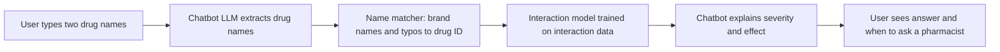

# MedCheck: Drug Interaction Chatbot

Nov 25, 2026 · @deniz

## Abstract

MedCheck is a chatbot that tells a user whether two medicines interact, how serious the interaction is, and what it does. The answer comes from a drug-interaction dataset and a model we trained on it, not from a general chatbot guessing. On a held-out test set, MedCheck detects interactions with \[X\]% accuracy and classifies severity with \[X\]% accuracy.

## Problem and why it matters

Many people take more than one medicine at once, often prescribed by different doctors or bought over the counter. Some combinations are harmful: they can cause bleeding, change how well a drug works, or add up side effects. Most people have no quick, reliable way to check a pair before taking it.

General chatbots can answer this question, but they can invent interactions or miss real ones, and they cannot show where an answer came from. For medicine, a confident wrong answer is dangerous.

\[Add one real statistic here about adverse drug interactions, with its source.\]

## What we predict, and how early

For any pair of medicines, MedCheck predicts three things:

1. **Interaction or not:** whether the two drugs are known to interact.
2. **Severity:** minor, moderate or major.
3. **Effect:** what the interaction does, in plain language (for example, higher bleeding risk).

The warning comes before the person takes the second medicine: at home, at the pharmacy counter, or when a new prescription arrives. It does not replace a doctor or pharmacist; it tells the user when to ask one.

## Data and model

MedCheck has two parts: a model that finds the interaction, and a chatbot that talks to the user. The chatbot never decides the answer; it only explains what the model found.

**Data.** We use DDInter, which lists drug pairs with their interaction and severity. 160,235 unique interacting drug pairs from DDInter: 26,914 major, 96,675 moderate, 6,833 minor, 29,813 unrated. (Might update if I can get the download link for DDInter 2.0)

**Model.** \[Describe the model: e.g. a classifier that takes two drugs and predicts interaction, severity and effect type.\] A name matcher maps brand names and typos (e.g. "Advil" to ibuprofen) to the right drug before the model runs.

**Chatbot.** \[Name the LLM.\] It reads the user's message, pulls out the drug names, and turns the model's output into a short, plain-language answer.

The user only talks to the chatbot, but the interaction answer always comes from the model and its data.

## How we tested it

We split the interaction data into training and test sets (\[80/20\]) so the model is scored on drug pairs it never saw. We also built a hand-checked set of \[N\] well-known pairs to test the full chatbot end to end.

| Test | What it measures | Result |
| --- | --- | --- |
| Interaction detection | Interaction vs. no interaction on the test set | \[X\]% accuracy, \[X\] F1 |
| Severity | Minor / moderate / major on the test set | \[X\]% accuracy |
| Missed major interactions | Major pairs the model called safe | \[X\] of \[N\] |
| Drug name matching | Brand names and typos mapped to the right drug | \[X\] of \[N\] |
| End-to-end chatbot | Known pairs (e.g. warfarin + aspirin) answered correctly | \[X\] of \[N\] |

Missed major interactions matter most: a false alarm costs a question to a pharmacist, a miss can cost harm. We report that number separately for that reason.

## Limits and next steps

**Limits**

- Not medical advice: MedCheck tells users when to ask a doctor or pharmacist, not what to do.
- It only knows drugs in the dataset; an unknown drug gets "not in our data", never a guess.
- It checks two drugs at a time, not a full medicine list.
- It ignores dose, age, kidney or liver function, and other conditions that change risk.

**Next steps**

- Check a whole medicine list, every pair at once.
- Add food and alcohol interactions (for example, grapefruit).
- Show the source record behind every answer.
- Support more languages, starting with \[Turkish\].

## Team and build log

| Name | Role | Builds | Writes | Presents |
| --- | --- | --- | --- | --- |
| Deniz | Data & Model | Dataset cleaning, interaction + severity model, model tests | Data and model; How we tested it | How it works; Results |
| Kunsh | Chatbot & Interface | LLM connection, drug name extraction, plain-language answers, web interface | Chatbot part; Limits and next steps | Hook and problem; Live demo |
| Kaustubh | Name Matching, Integration & Testing | Name matcher, model-to-chatbot connection, hand-checked test list | Problem; What we predict; build log | Team and what's next; backup demo video |

Shared: agree on the model's input and output on day one, read the final manuscript together, and everyone tests the demo before the final day.

Add a line here every day you work: what you built, what you tried, what number you got. These notes become the results and limits sections above.

| Date | What we did | Result or decision |
| --- | --- | --- |
| \[date\] | \[e.g. picked dataset\] | \[e.g. DDInter, N pairs\] |
