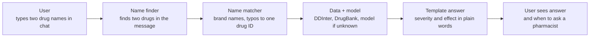

# MedCheck: Drug Interaction Chatbot

Nov 26, 2026 · Deniz

## Abstract

MedCheck is a chatbot that tells a user whether two medicines interact, how serious the interaction is, and what it does. The answer comes from two drug interaction databases (DDInter and DrugBank) and a model trained on them, and everything runs offline. On 64,094 drug pairs it never saw in training, MedCheck detects interactions with 84.9% accuracy and classifies severity with 83.2% accuracy.
After tuning it for safety, it finds 92.6% of major interactions and calls only 2.5% of them "no interaction".

## Problem and why it matters

Many people take more than one medicine at once, often prescribed by different doctors or bought over the counter. Some combinations are harmful and they can cause bleeding, change how well a drug works, or add up side effects. Most people have no quick, reliable way to check a pair before taking it.

General chatbots can answer this question, but they can invent interactions or miss real ones, and they cannot show where an answer came from. For medicine, a confident wrong answer is dangerous.

The risk is largest for older adults. In the United States, 43.0% of adults aged 65 and over took five or more prescription drugs in the past 30 days (2017 to March 2020), up from 33.3% in 2001 to 2004 ([CDC, Health, United States](https://www.cdc.gov/nchs/hus/topics/rx-drug-use.htm)). More than 1.5 million people visit emergency departments for adverse drug events each year, and adults 65 and older account for more than 600,000 of those visits ([CDC](https://www.cdc.gov/medication-safety/data-research/facts-stats/index.html)).

## What I predicted, and how early

For any pair of medicines, MedCheck predicts three things:

1. **Interaction or not:** whether the two drugs are known to interact.
2. **Severity:** minor, moderate or major.
3. **Effect:** what the interaction does, in plain language (for example, higher bleeding risk).

The warning comes before the person takes the second medicine: at home, at the pharmacy counter, or when a new prescription arrives. It does not replace a doctor or pharmacist; it tells the user when to ask one.

## Data and model

MedCheck has two parts: a model that finds the interaction, and a chatbot that talks to the user. The chatbot never decides the answer; it only explains what the model found.

**Data.** I used DDInter, which lists drug pairs with their interaction severity. After merging its 8 files and removing duplicates, there are 160,235 unique interacting pairs: 26,914 major, 96,675 moderate, 6,833 minor and 29,813 with no severity rating. I added non-interacting pairs so the model also learns what "safe" looks like. For "what can happen", I used DrugBank 5.1 interaction types (via Mendeley Data): 1,224 of its 1,868 drugs match DDInter names, giving an effect such as "risk or severity of bleeding" for 128,934 pairs. Of these, 39,396 are also in DDInter and 89,538 are listed only in DrugBank, which gives a second source for pairs DDInter does not cover.

**Model.** Two gradient-boosted tree classifiers (scikit-learn HistGradientBoostingClassifier): one predicts whether a pair interacts, the other predicts minor, moderate or major. Each drug is described by its known interactions (how many, and what share are minor, moderate or major), and each pair by how many interaction partners the two drugs share. Training features are built out-of-fold, so a pair's own label never leaks into its features. Instead of a 50% cut-off, I used safety thresholds picked on a separate 10% validation split: a pair counts as interacting above 18.6% probability, and as major above 25.5%. Pairs already in DDInter are answered directly from the data; the models only estimate pairs that are not listed. A name matcher maps brand names and typos (e.g. "Advil" to ibuprofen) to the right drug before the model runs.

**Chatbot.** No large language model. A name matcher finds the two drugs in the user's message, recognizing 132 brand names older adults often take (e.g. Coumadin for warfarin, Advil for ibuprofen; all 132 found in DDInter's 1,939 drugs) and fixing typos with fuzzy matching. The answer is written from fixed templates, so every sentence comes from the data or the model's output. The interface is a Streamlit chat app that runs fully offline.

The user only talks to the chat app, but every answer comes from DDInter, DrugBank or the model, never from a language model.

## How I tested it

I split the interaction data into training and test sets (80/20) so the model is scored on drug pairs it never saw. Safety thresholds were picked on a separate 10% validation split, never on the test set.

| Test | What it measures | Default (50% cut-off) | Safety thresholds (used in app) |
| --- | --- | --- | --- |
| Interaction detection | Interaction vs. no interaction, 64,094 test pairs | 84.9% accuracy, 0.854 F1 | 78.1% accuracy, 0.816 F1 |
| Severity | Minor / moderate / major, 26,031 rated test pairs | 83.2% accuracy, 0.743 macro F1 | 77.8% accuracy, 0.707 macro F1 |
| Baseline | Always guessing "moderate" | 74.1% accuracy, about 0.28 macro F1 | same |
| Major recall | Major pairs rated major | 85.5% | 92.6% |
| Missed major interactions | Major pairs called "no interaction" (of 5,356) | 409 | 133 |
| Brand name coverage | Brand names found in DDInter | 132 of 132 | same |
| DrugBank match | DrugBank drugs matched to DDInter names | 1,224 of 1,868 | same |

Missed major interactions matter most: a false alarm costs a question to a pharmacist, a miss can cost harm. So MedCheck uses the safety thresholds: misses drop by 67%, at the cost of about 1,800 more moderate pairs flagged as major.

**Comparison with ChatGPT.** I picked 30 random pairs from the test set with a fixed seed (10 major, 5 moderate, 5 minor, and 10 listed in neither DDInter nor DrugBank) and asked ChatGPT for the severity of each, all in one message.

| On the 20 pairs listed in DDInter | ChatGPT | MedCheck |
| --- | --- | --- |
| Severity matches DDInter | 12 of 20 | 20 of 20 |
| Called a listed interaction "none" | 3 | 0 |
| Major interactions rated major | 6 of 10 | 10 of 10 |

MedCheck matches these pairs by design, because it looks them up in DDInter; the point is that ChatGPT guesses. For example, DDInter rates leflunomide with clotrimazole as major, and ChatGPT answered "none". Disagreeing with DDInter is not always an error, since sources can differ, and on the 10 unlisted pairs I did not score ChatGPT, because a missing pair is not proof of safety. This is a small test: 30 pairs, one message, one run. The pairs and answers are in results/chatgpt_comparison.csv.

## Limits and next steps

**Limits**

- Not medical advice: MedCheck tells users when to ask a doctor or pharmacist, not what to do.
- It only knows drugs in its data; an unknown drug gets "not in our data", never a guess.
- It checks two drugs at a time, not a full medicine list.
- "No interaction" training pairs are random pairs DDInter does not list, which is an approximation: a missing pair is not proof of safety.
- 29,813 known interactions (19%) have no severity rating in DDInter; I reported these as "interaction, severity unrated".
- The model still misses some dangerous pairs: even with safety thresholds, 2.5% of major test pairs were called "no interaction", and only 54% of major alarms are truly major.
- DrugBank effects show what is affected, not the direction ("can affect the risk of bleeding", not "increases"), and only 1,224 of its 1,868 drugs match DDInter names.
- Combination products (e.g. Sinemet) are matched to one active ingredient.
- It ignores dose, age, kidney or liver function, and other conditions that change risk.

**Next steps**

- Check a whole medicine list, every pair at once.
- Add food and alcohol interactions (for example, grapefruit).
- Show whether an effect goes up or down, using full DrugBank or DDInter 2.0 data.
- Remove DrugBank-listed pairs from the "no interaction" training examples and retrain.
- Support more languages, starting with Turkish.

## Team and build log

| Name | Role |
| --- | --- |
| Deniz | Data, model, chat app, testing, manuscript and demo |

Build log:

| Date | What I did | Result or decision |
| --- | --- | --- |
| Nov 26 | Compared MedCheck with ChatGPT on 30 random test pairs | ChatGPT matched DDInter on 12 of 20 listed pairs |
| Nov 26 | Built the Streamlit chat app with colored answers and example buttons | Fully offline, no usage stats sent |
| Nov 26 | Added DrugBank effects via Mendeley Data | 128,934 pairs with an effect, 89,538 not in DDInter |
| Nov 26 | Built the name matcher with brand names older adults often take | All 132 brand names found in DDInter |
| Nov 26 | Added safety thresholds, picked on a validation split | Missed major pairs: 409 to 133 |
| Nov 26 | Trained interaction and severity models | 84.9% interaction accuracy, 83.2% severity accuracy |
| Nov 25 | Found that leave-one-out features leaked labels (near-perfect training score, chance-level test score); switched to out-of-fold features | Fixed before any reported result |
| Nov 25 | Merged the 8 DDInter files, removed duplicates, split 80/20 | 160,235 unique interacting pairs; 29,813 unrated |
| Nov 25 | Picked DDInter as the main data source | Free, has severity levels; DDInter 2.0 full data requested by email, no reply yet |
