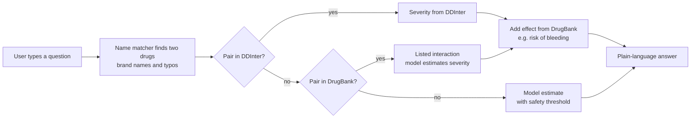

# MedCheck

**Ask about two medicines, get a data-backed answer: do they interact, how serious is it, and what can happen.**

MedCheck is a drug interaction checker with a chat interface. Answers come from two clinical drug interaction databases (DDInter and DrugBank). For pairs that neither database lists, a machine learning model estimates the risk, tuned to catch dangerous interactions. Everything runs offline on your own computer.

> ⚠️ **Not medical advice.** MedCheck tells you when to talk to a doctor or pharmacist. It does not replace one.

## Why not just ask ChatGPT?

- **It looks answers up instead of generating them.** Every interaction comes from a database record or a measured model, so nothing is made up.
- **Its accuracy is measured.** We tested it on 64,094 drug pairs it never saw (see Results).
- **It says when it doesn't know.** An unknown drug gets "not in our data", never a guess.
- **Your medicine list never leaves your device.** No internet, no API, no account.

## How it works



1. **You ask** about two medicines, e.g. *"My grandma takes Coumadin and Advil every day"*.
2. **The name matcher** finds the two drugs: 132 common brand names (e.g. Coumadin → warfarin) and typos.
3. **Known pair?** The severity (major / moderate / minor) comes straight from DDInter.
4. **What can happen?** If DrugBank lists the pair, MedCheck adds the effect (e.g. "can affect the risk of bleeding").
5. **Unknown pair?** The model estimates whether the drugs interact and how seriously.
6. **The answer** is written from fixed templates, not an LLM, so it can't invent anything.

## Results

Scores on 64,094 test pairs the model never saw. The app uses the safety thresholds, picked on a separate validation split to catch dangerous interactions.

| Metric | Default (50% cut-off) | Safety thresholds (used in app) |
| --- | --- | --- |
| Interaction accuracy | 84.9% | 78.1% |
| Severity accuracy | 83.2% | 77.8% |
| Severity macro F1 | 0.743 | 0.707 |
| Major interactions found | 85.5% | **92.6%** |
| Major pairs called "no interaction" | 409 of 5,356 | **133 of 5,356** |

Baseline (always guessing "moderate"): 74.1% severity accuracy, about 0.28 macro F1, and it never flags a major interaction.

### Compared with ChatGPT

I have picked 30 random pairs from the test set (fixed seed: 10 major, 5 moderate, 5 minor, 10 listed in no database) and asked ChatGPT for each severity, in one message.

| On the 20 pairs listed in DDInter | ChatGPT | MedCheck |
| --- | --- | --- |
| Severity matches DDInter | 12 of 20 | 20 of 20 |
| Called a listed interaction "none" | 3 | 0 |
| Major interactions rated major | 6 of 10 | 10 of 10 |

MedCheck matches these pairs by design, because it looks them up; the point is that ChatGPT guesses. For example, DDInter rates leflunomide with clotrimazole as major, and ChatGPT answered "none". Sources can differ, so a disagreement is not always an error, and we did not score ChatGPT on the 10 unlisted pairs. Small test: 30 pairs, one run. Repeat it with `python -m tests.chatgpt_comparison`; pairs and answers are in [results/chatgpt_comparison.csv](results/chatgpt_comparison.csv).

### Model scores

These scores are for pairs **not** in the data. Pairs already listed in DDInter are answered directly from the database. Full results are in [results/metrics.txt](results/metrics.txt) and [MANUSCRIPT.md](MANUSCRIPT.md).

## Getting started

**1. Clone the repo and install the requirements** (Python 3.10+)

```bash
git clone https://github.com/denizautn/MedCheck.git
cd MedCheck
pip install -r requirements.txt
```

**2. Download the data** (not included in the repo)

- **DDInter:** download all 8 CSV files from [ddinter2.scbdd.com/download](https://ddinter2.scbdd.com/download/) into `data/raw/`.
- **DrugBank interaction types:** download the dataset from [Mendeley Data](https://data.mendeley.com/datasets/md5czfsfnd/1) and put `DDI_data.csv` in `data/raw/drugbank/`.

**3. Prepare the data and train the model**

```bash
python model/prepare_data.py
python -m model.prepare_effects
python -m model.train
python -m model.evaluate
```

**4. Run the app**

```bash
streamlit run app.py
```

Try it from the command line too: `python -m model.predict warfarin aspirin`

## Project structure

```
MedCheck/
├── app.py                    # Streamlit chat interface
├── .streamlit/config.toml    # theme, no usage stats sent (offline)
├── chatbot/
│   ├── brand_names.py        # 132 brand and common names -> generic names
│   ├── name_matcher.py       # finds drug names in a sentence, fixes typos
│   └── responses.py          # plain-language answer templates
├── model/
│   ├── prepare_data.py       # merges DDInter, removes duplicates, train/test split
│   ├── prepare_effects.py    # matches DrugBank effects to DDInter pairs
│   ├── features.py           # describes each drug pair with numbers (out-of-fold)
│   ├── train.py              # trains interaction + severity models
│   ├── decision.py           # safety thresholds
│   ├── evaluate.py           # test-set scores -> results/metrics.txt
│   └── predict.py            # predict(drug_a, drug_b) used by the app
├── results/metrics.txt       # latest test results
└── data/                     # raw and processed data (not committed)
```

## Data

| Source | What we use | License |
| --- | --- | --- |
| [DDInter](https://ddinter2.scbdd.com/) | 160,235 unique interacting drug pairs with severity (26,914 major, 96,675 moderate, 6,833 minor, 29,813 unrated) | CC BY-NC-SA 4.0 |
| [DrugBank 5.1 interaction types via Mendeley Data](https://data.mendeley.com/datasets/md5czfsfnd/1) | 128,934 pairs with an effect type (e.g. risk of bleeding), matched to DDInter drug names | CC BY 4.0 |

Please cite:
- Tian Y. et al. *DDInter 2.0: an enhanced drug interaction resource with expanded data coverage, new interaction types, and improved user interface.* Nucleic Acids Research 53(D1):D1356, 2025.
- *Data of multiple-type drug-drug interactions*, Mendeley Data, V1, doi:10.17632/md5czfsfnd.1 (extracted from DrugBank 5.1).

MedCheck is a non-commercial student project.

## Limitations

- Checks two drugs at a time, not a full medicine list.
- DrugBank effects show what is affected, not the direction (e.g. "can affect the risk of bleeding", not "increases").
- "No interaction" training pairs are random pairs DDInter does not list, which is an approximation.
- Combination products (e.g. Sinemet) are matched to one active ingredient.
- Does not consider dose, age, kidney or liver function.

## Team

| Name | Role |
| --- | --- |
| Deniz | Data, model, app and testing |

Built with help from Claude for code and double checking.
